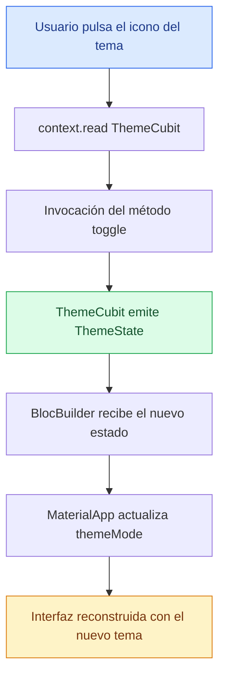
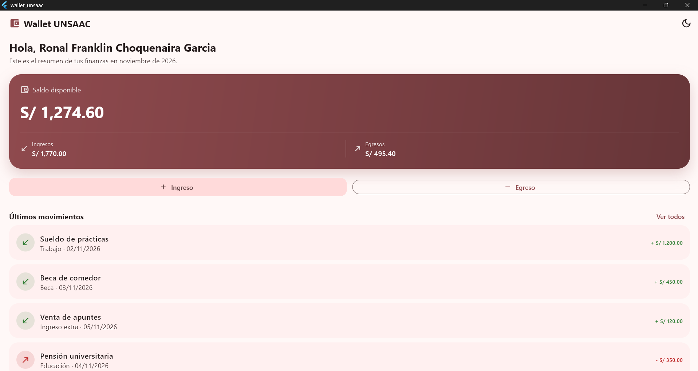
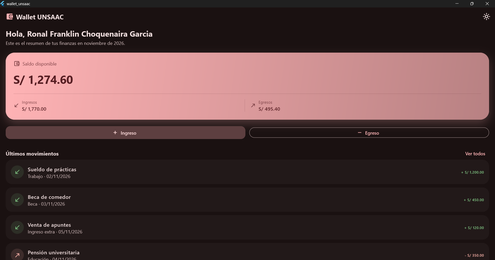
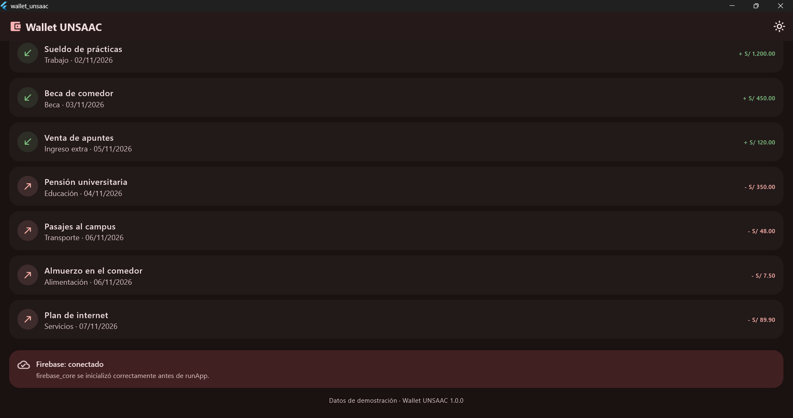

# Wallet UNSAAC

## Autor

- **Ronal Franklin**

---

## 1. Software utilizadas

| Tecnología | Versión |
|---|---|
| Flutter | 3.47.5 |
| Dart | 3.13.4 |
| FlutterFire CLI | 1.5.0 |
| Firebase CLI | Instalado |
| Firebase Project ID | wallet-unsaac |
| Arquitectura | BLoC / Cubit |
| Lenguaje | Dart |

## 2. Requisitos previos

Para ejecutar el proyecto se requiere:

- Flutter SDK 3.47.5.
- Dart SDK 3.13.4.
- Android Studio o Visual Studio Code.
- Android SDK.
- Firebase CLI.
- FlutterFire CLI.
- Cuenta de Google con acceso al proyecto Firebase.

## 3. Instalación y ejecución

El proyecto se encuentra organizado localmente en el directorio `wallet_unsaac`.

### 3.1. Abrir el proyecto

Abrir la carpeta `wallet_unsaac` desde Visual Studio Code.

### 3.2. Instalar dependencias

Desde la terminal, ubicada en la raíz del proyecto, ejecutar:

```bash
flutter pub get
```

### 3.3. Verificar dispositivos disponibles

```bash
flutter devices
```

### 3.4. Ejecutar la aplicación

```bash
flutter run
```

### 3.5. Analizar el código

```bash
flutter analyze
```

Resultado obtenido:

```text
Analyzing wallet_unsaac...
No issues found!
```

### 3.6. Ejecutar pruebas

```bash
flutter test
```

## 4. Configuración de Firebase

El proyecto Wallet UNSAAC está integrado con Firebase mediante FlutterFire CLI.

### 4.1. Iniciar sesión en Firebase

Ejecutar:

```bash
firebase login
```

### 4.2. Consultar proyectos Firebase

```bash
firebase projects:list
```

Proyecto utilizado:

| Propiedad | Valor |
|---|---|
| Nombre del proyecto | wallet-unsaac |
| Project ID | wallet-unsaac |
| Project Number | 553611006077 |

### 4.3. Instalar FlutterFire CLI

Ejecutar:

```bash
dart pub global activate flutterfire_cli
```

En Windows, agregar la siguiente ruta a la variable de entorno PATH:

```text
%LOCALAPPDATA%\Pub\Cache\bin
```

Verificar la instalación:

```bash
flutterfire --version
```

Versión instalada:

```text
1.5.0
```

### 4.4. Configurar Firebase para Flutter

Desde el directorio raíz del proyecto ejecutar:

```bash
flutterfire configure
```

Seleccionar el proyecto:

```text
wallet-unsaac
```

Plataformas configuradas:

- Android
- iOS
- macOS
- Web
- Windows

El proceso genera el archivo:

```text
lib/firebase_options.dart
```

### 4.5. Aplicaciones registradas en Firebase

Las siguientes aplicaciones fueron registradas en el proyecto Firebase:

| Plataforma | Identificador |
|---|---|
| Android | pe.edu.unsaac.wallet_unsaac |
| iOS | pe.edu.unsaac.walletUnsaac |
| macOS | pe.edu.unsaac.walletUnsaac |
| Web | wallet_unsaac |
| Windows | wallet_unsaac |

### 4.6. Inicialización de Firebase

Firebase debe inicializarse antes de ejecutar la aplicación, utilizando `Firebase.initializeApp()` y las opciones correspondientes a cada plataforma.

Ejemplo de inicialización:

```dart
WidgetsFlutterBinding.ensureInitialized();

await Firebase.initializeApp(
  options: DefaultFirebaseOptions.currentPlatform,
);
```

La inicialización puede estar centralizada en la clase `FirebaseBootstrap`, según la implementación del proyecto.

### 4.7. Permiso de Internet en Android

Verificar que el archivo:

```text
android/app/src/main/AndroidManifest.xml
```

Contenga el permiso:

```xml
<uses-permission android:name="android.permission.INTERNET"/>
```

## 5. Arquitectura y estructura del proyecto

El proyecto utiliza una organización modular basada en separación de responsabilidades, con componentes comunes en `core/` y funcionalidades específicas en `features/`.

Estructura de referencia:

```text
wallet_unsaac/
│
├── android/
├── ios/
├── macos/
├── web/
├── windows/
│
├── lib/
│   ├── core/
│   │   ├── theme/
│   │   │   ├── theme_cubit.dart
│   │   │   └── theme_state.dart
│   │   │
│   │   └── firebase/
│   │       └── firebase_bootstrap.dart
│   │
│   ├── features/
│   │   └── wallet/
│   │       ├── data/
│   │       ├── domain/
│   │       └── presentation/
│   │
│   ├── firebase_options.dart
│   └── main.dart
│
├── test/
├── screenshots/
│
├── .gitignore
├── pubspec.yaml
├── pubspec.lock
└── README.md
```

**Nota:** Esta estructura es una referencia y debe corresponder a los directorios y archivos reales del proyecto.

## 6. Gestión del tema mediante ThemeCubit

La aplicación utiliza el patrón Cubit de Flutter BLoC para administrar el estado del tema visual.

El usuario puede cambiar entre los modos de visualización disponibles. El cambio se gestiona mediante `ThemeCubit`, que emite un nuevo estado representado por `ThemeState`.

### 6.1. Diagrama de flujo evento–estado

El siguiente diagrama representa el proceso de actualización del tema:



### 6.2. Funcionamiento

1. El usuario pulsa el icono para cambiar el tema.
2. Se invoca el método `toggle()` de `ThemeCubit`.
3. `ThemeCubit` genera y emite un nuevo `ThemeState`.
4. `BlocBuilder` detecta el cambio de estado.
5. `MaterialApp` recibe el nuevo valor de `themeMode`.
6. Flutter reconstruye la interfaz con el tema seleccionado.

## 7. Capturas de pantalla

Las evidencias visuales permiten comprobar el funcionamiento de la aplicación Wallet UNSAAC.

Las capturas se almacenan en el directorio `screenshots/`.

### 7.1. Pantalla principal



### 7.2. Tema claro



### 7.3. Tema oscuro


### 7.4. Estado de Firebase




## 8. Seguridad y archivos excluidos de Git

Por seguridad, el repositorio no debe contener credenciales privadas ni archivos de firma de Android.

El archivo `.gitignore` debe incluir las siguientes exclusiones:

```gitignore
# Firebase y credenciales
google-services.json
GoogleService-Info.plist
firebase-adminsdk*.json

# Claves de firma Android
key.properties
*.jks
*.keystore

# Archivos generados por Flutter
.dart_tool/
.flutter-plugins
.flutter-plugins-dependencies
build/
```

El archivo `pubspec.lock` debe mantenerse versionado para conservar las versiones de las dependencias utilizadas.

El archivo `lib/firebase_options.dart` contiene opciones de configuración de Firebase y no debe confundirse con una clave privada de cuenta de servicio.

### 8.1. Verificar archivos excluidos

Ejecutar en PowerShell:

```powershell
git check-ignore google-services.json
git check-ignore key.properties
git check-ignore android/app/key.jks
```

Verificar que no existan archivos sensibles versionados:

```powershell
git ls-files | Select-String "google-services.json|key.properties|.jks|.keystore"
```

Este último comando no muestra archivos sensibles.

## 9. Lista de verificación del taller

| N.º | Verificación | Cumple |
|---:|---|:---:|
| 1 | Proyecto creado con applicationId único. | [X] |
| 2 | Dependencias instaladas y pubspec.lock versionado. | [ ] |
| 3 | Estructura core/ + features/wallet/ completa. | [X] |
| 4 | ThemeState inmutable con Equatable. | [X] |
| 5 | ThemeCubit con toggle, setMode y useSystemMode. | [ ] |
| 6 | BlocProvider y BlocBuilder conectados a MaterialApp. | [ ] |
| 7 | Tema Material 3 con ColorScheme.fromSeed. | [ ] |
| 8 | Dominio con entidades y cálculo de saldo. | [ ] |
| 9 | Contrato de repositorio e implementación en memoria. | [ ] |
| 10 | FirebaseBootstrap y estado visible en la app. | [X] |
| 11 | Permiso INTERNET en el manifiesto principal. | [X] |
| 12 | flutter analyze sin errores. | [x] |
| 13 | App ejecutada en emulador o dispositivo con capturas. | [x] |
| 14 | README y repositorio remoto configurados. | [X] |

# 10. Versionamiento con Git y GitHub

El proyecto se encuentra inicialmente en un directorio local. Para versionarlo y publicarlo en GitHub se realizarán los siguientes pasos.

### 10.1. Inicializar Git

Desde la raíz del proyecto ejecutar:

```bash
git init
```

### 10.2. Agregar los archivos

```bash
git add .
```

### 10.3. Verificar los archivos preparados

```bash
git status
```

### 10.4. Crear el primer commit

```bash
git commit -m "Sesión 1: arquitectura BLoC y Firebase para Android"
```

### 10.5. Crear el repositorio en GitHub

1. Ingresar a https://github.com/.
2. Iniciar sesión con la cuenta correspondiente.
3. Seleccionar la opción **New repository**.
4. Escribir como nombre del repositorio `wallet_unsaac`.
5. Seleccionar la visibilidad deseada.
6. Crear el repositorio sin inicializar archivos adicionales, ya que el proyecto se encuentra localmente.

### 10.6. Conectar el repositorio local con GitHub

Después de crear el repositorio, copiar su URL y ejecutar:

```bash
git remote add origin [URL_DEL_REPOSITORIO]
git branch -M main
git push -u origin main
```


## 11. Reto 1 — Tema persistente entre sesiones

### 11.1. Objetivo del reto

El objetivo de este reto fue hacer que la aplicación Wallet UNSAAC recuerde el tema que selecciona el usuario, de manera que al cerrar y volver a abrir la aplicación se mantenga la misma apariencia que había elegido anteriormente.

Para lograrlo, implementé un sistema de almacenamiento local utilizando `shared_preferences`, junto con `ThemeCubit` para controlar los cambios de tema. También se agregó la opción de utilizar el tema del sistema, permitiendo que la aplicación se adapte automáticamente a la configuración del dispositivo.

### 11.2. Tecnologías utilizadas

| Tecnología | Utilidad |
|---|---|
| Flutter | Desarrollo de la aplicación. |
| Dart | Lenguaje de programación. |
| shared_preferences | Almacenamiento local de la preferencia del tema. |
| Flutter BLoC / Cubit | Gestión del estado del tema. |
| Flutter Test | Ejecución de pruebas automatizadas. |

### 11.3. Funcionamiento de la persistencia del tema

Para implementar esta funcionalidad, utilicé `shared_preferences`, que permite guardar pequeños datos en el dispositivo y recuperarlos cuando se vuelve a iniciar la aplicación.

El funcionamiento es el siguiente:

1. Cuando se inicia la aplicación, se recupera el último tema que había seleccionado el usuario.
2. Si existe un tema guardado, se utiliza esa configuración para iniciar la aplicación.
3. Si todavía no existe una preferencia guardada, se utiliza `ThemeMode.system` como configuración inicial.
4. Cuando el usuario cambia el tema, `ThemeCubit` actualiza el estado y guarda inmediatamente la nueva selección.
5. Si se cierra completamente la aplicación y se vuelve a abrir, se recupera el último tema guardado.

De esta manera, el usuario ya no necesita seleccionar nuevamente su tema cada vez que ingresa a la aplicación.

### 11.4. Modos de visualización

Se implementaron tres opciones de tema:

| Modo | Descripción |
|---|---|
| Claro | Muestra la aplicación con colores claros. |
| Oscuro | Muestra la aplicación con colores oscuros. |
| Sistema | Adapta automáticamente la apariencia según la configuración del dispositivo. |

El botón encargado de cambiar el tema sigue este orden:

**Claro → Oscuro → Sistema → Claro**

También se actualizan el icono y el tooltip del botón para indicar el modo que se encuentra seleccionado actualmente.

### 11.5. Archivos modificados

Para realizar este reto, se trabajó principalmente con los siguientes archivos:

| Archivo | Función |
|---|---|
| `pubspec.yaml` | Se agregó la dependencia `shared_preferences`. |
| `lib/core/theme/theme_preferences.dart` | Se encarga de guardar y recuperar la preferencia del tema. |
| `lib/core/theme/theme_cubit.dart` | Administra los cambios de tema y guarda la nueva selección. |
| `lib/main.dart` | Recupera la preferencia almacenada antes de ejecutar `runApp`. |
| `test/` | Contiene las pruebas realizadas para comprobar el funcionamiento de la persistencia. |

### 11.6. Manejo de valores inválidos

También se tuvo en cuenta el caso en el que el valor almacenado no exista o se encuentre corrupto.

Para evitar que esto genere errores al iniciar la aplicación, se estableció `ThemeMode.system` como valor predeterminado cuando no se reconoce la preferencia guardada.

De esta manera, la aplicación puede continuar funcionando normalmente aunque el dato almacenado no sea válido.

### 11.7. Importancia de cargar el tema antes de runApp

La lectura de la preferencia se realiza en `main.dart`, antes de ejecutar `runApp`.

Decidí hacerlo de esta manera porque, si la lectura se realizara después de mostrar la pantalla principal, primero podría aparecer la aplicación con el tema predeterminado y luego cambiar al tema guardado por el usuario.

Esto provocaría un cambio visual innecesario al iniciar la aplicación.

Al recuperar la preferencia antes de ejecutar `runApp`, la aplicación comienza directamente con el tema correcto y se evita ese cambio visual.

### 11.8. Pruebas realizadas

Para comprobar que la funcionalidad trabaja correctamente, se agregaron pruebas utilizando las herramientas de Flutter.

Las pruebas permiten verificar los siguientes comportamientos:

- Guardar una preferencia de tema y recuperarla posteriormente.
- Comprobar que los cambios realizados desde `ThemeCubit` se almacenan correctamente.
- Verificar que la aplicación utiliza `ThemeMode.system` cuando no existe una preferencia guardada.
- Comprobar que un valor desconocido o inválido no provoca una excepción.

Para ejecutar las pruebas del proyecto se utiliza el siguiente comando:

```bash
flutter test
```

### 11.9. Resultado del reto

Con la implementación de este reto, la aplicación Wallet UNSAAC ya puede recordar la preferencia visual del usuario entre diferentes sesiones.

Además, los cambios de tema se administran mediante `ThemeCubit`, evitando utilizar `setState` para esta funcionalidad y manteniendo la separación de responsabilidades dentro del proyecto.

De esta manera, se cumplió el objetivo principal del reto: conservar el tema seleccionado incluso después de cerrar completamente y volver a iniciar la aplicación.


---

# 12. Reto 3 — Saldo con estados de carga, éxito y error

## 12.1. Objetivo y alcance

El objetivo de este reto fue mejorar la gestión del saldo de la billetera utilizando `BalanceCubit` de Flutter BLoC, reemplazando el uso de `FutureBuilder` para separar la lógica de los datos de la interfaz.

Se implementaron estados de carga, éxito y error, mostrando el resumen financiero, los últimos movimientos y opciones para reintentar o actualizar los datos mediante `RefreshIndicator`. También se realizaron pruebas automatizadas para verificar su funcionamiento.

**Alcance pendiente:** Se mantuvo `InMemoryWalletRepository` con datos de demostración. Todavía no se implementó la conexión con Firestore ni el almacenamiento permanente de ingresos y egresos.

## 12.2. Diseño de la solución

Para este reto se utilizó Cubit de Flutter BLoC para controlar los estados de la consulta financiera. Se creó `BalanceCubit`, que recibe `WalletRepository` mediante inyección de dependencias, evitando depender de una implementación específica.

Además, se utilizó `BlocBuilder` para escuchar los cambios de estado y actualizar automáticamente la pantalla según los datos obtenidos.

### Representación del error

El error se representa mediante `BalanceFailure`, que muestra un mensaje de error y la opción de volver a intentarlo.

### Funcionamiento del reintento

Mediante `_reload()`, que ejecuta nuevamente `load()` para actualizar los datos. Este método también se utiliza con `RefreshIndicator`.

### Acceso al repositorio

El encargado de llamar al repositorio es `BalanceCubit`, mediante su método `load()`. La pantalla solamente escucha los estados y actualiza la información.

### Estados implementados

| Estado | Cuándo se emite | Qué muestra la interfaz |
|---|---|---|
| `BalanceInitial` | Al iniciar el Cubit. | Estado inicial de la consulta. |
| `BalanceLoading` | Cuando comienza una consulta. | Indicador circular y mensaje «Cargando saldo...». |
| `BalanceSuccess` | Cuando se obtiene correctamente el resumen financiero. | Saldo, ingresos, egresos y últimos movimientos. |
| `BalanceFailure` | Cuando ocurre un error durante la consulta. | Mensaje de error y botón «Reintentar». |

## 12.3. Implementación

Los principales archivos utilizados para desarrollar el reto fueron:

| Archivo | Propósito | Cambios realizados |
|---|---|---|
| `lib/features/wallet/presentation/cubits/balance_state.dart` | Definir los estados del saldo. | Se implementaron `BalanceInitial`, `BalanceLoading`, `BalanceSuccess` y `BalanceFailure`. |
| `lib/features/wallet/presentation/cubits/balance_cubit.dart` | Gestionar la consulta financiera. | Se implementó `load()`, la emisión de estados y el manejo de excepciones. |
| `lib/app.dart` | Configurar los proveedores. | Se integró `BalanceCubit` con el repositorio mediante inyección de dependencias. |
| `lib/features/wallet/data/repositories/in_memory_wallet_repository.dart` | Proporcionar datos de demostración. | Se mantiene como implementación temporal del repositorio. |
| `test/features/wallet/presentation/cubits/balance_cubit_test.dart` | Probar el funcionamiento del Cubit. | Se implementaron pruebas de éxito, error y reintento. |
| `test/features/wallet/presentation/pages/wallet_home_page_test.dart` | Probar la interfaz principal. | Se verificó la visualización del saldo y los movimientos. |

### Explicación de `isClosed`

Permite comprobar si el Cubit sigue abierto antes de emitir un estado. Así se evitan errores cuando una consulta asíncrona termina después de que el Cubit se haya cerrado.

## 12.4. Pruebas ejecutadas

Se realizaron pruebas automatizadas para comprobar los diferentes comportamientos de `BalanceCubit`.

| Prueba | Qué verifica | Resultado |
|---|---|---|
| Éxito | Emite `BalanceLoading` y posteriormente `BalanceSuccess` cuando la consulta funciona correctamente. | Aprobada |
| Error | Emite `BalanceLoading` y posteriormente `BalanceFailure` cuando ocurre una excepción. | Aprobada |
| Reintento | Después de un error, vuelve a consultar el repositorio y consigue emitir `BalanceSuccess`. | Aprobada |

Para ejecutar las pruebas se utilizó el siguiente comando:

```bash
flutter test
