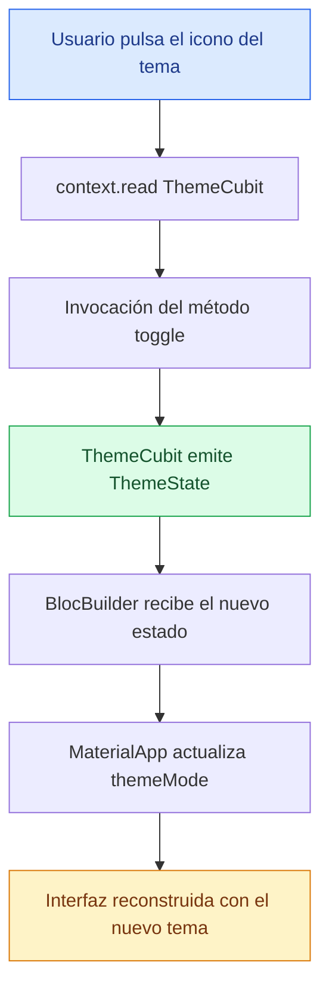

# Wallet UNSAAC

## Autor

- **Ronal Franklin**

---

## 1. Software utilizadas

| Tecnología | Versión |
|---|---|
| Flutter | 3.47.5 |
| Dart | 3.13.4 |
| FlutterFire CLI | 1.5.0 |
| Firebase CLI | Instalado |
| Firebase Project ID | wallet-unsaac |
| Arquitectura | BLoC / Cubit |
| Lenguaje | Dart |

## 2. Requisitos previos

Para ejecutar el proyecto se requiere:

- Flutter SDK 3.47.5.
- Dart SDK 3.13.4.
- Android Studio o Visual Studio Code.
- Android SDK.
- Firebase CLI.
- FlutterFire CLI.
- Cuenta de Google con acceso al proyecto Firebase.

## 3. Instalación y ejecución

El proyecto se encuentra organizado localmente en el directorio `wallet_unsaac`.

### 3.1. Abrir el proyecto

Abrir la carpeta `wallet_unsaac` desde Visual Studio Code.

### 3.2. Instalar dependencias

Desde la terminal, ubicada en la raíz del proyecto, ejecutar:

```bash
flutter pub get
```

### 3.3. Verificar dispositivos disponibles

```bash
flutter devices
```

### 3.4. Ejecutar la aplicación

```bash
flutter run
```

### 3.5. Analizar el código

```bash
flutter analyze
```

Resultado obtenido:

```text
Analyzing wallet_unsaac...
No issues found!
```

### 3.6. Ejecutar pruebas

```bash
flutter test
```

## 4. Configuración de Firebase

El proyecto Wallet UNSAAC está integrado con Firebase mediante FlutterFire CLI.

### 4.1. Iniciar sesión en Firebase

Ejecutar:

```bash
firebase login
```

### 4.2. Consultar proyectos Firebase

```bash
firebase projects:list
```

Proyecto utilizado:

| Propiedad | Valor |
|---|---|
| Nombre del proyecto | wallet-unsaac |
| Project ID | wallet-unsaac |
| Project Number | 553611006077 |

### 4.3. Instalar FlutterFire CLI

Ejecutar:

```bash
dart pub global activate flutterfire_cli
```

En Windows, agregar la siguiente ruta a la variable de entorno PATH:

```text
%LOCALAPPDATA%\Pub\Cache\bin
```

Verificar la instalación:

```bash
flutterfire --version
```

Versión instalada:

```text
1.5.0
```

### 4.4. Configurar Firebase para Flutter

Desde el directorio raíz del proyecto ejecutar:

```bash
flutterfire configure
```

Seleccionar el proyecto:

```text
wallet-unsaac
```

Plataformas configuradas:

- Android
- iOS
- macOS
- Web
- Windows

El proceso genera el archivo:

```text
lib/firebase_options.dart
```

### 4.5. Aplicaciones registradas en Firebase

Las siguientes aplicaciones fueron registradas en el proyecto Firebase:

| Plataforma | Identificador |
|---|---|
| Android | pe.edu.unsaac.wallet_unsaac |
| iOS | pe.edu.unsaac.walletUnsaac |
| macOS | pe.edu.unsaac.walletUnsaac |
| Web | wallet_unsaac |
| Windows | wallet_unsaac |

### 4.6. Inicialización de Firebase

Firebase debe inicializarse antes de ejecutar la aplicación, utilizando `Firebase.initializeApp()` y las opciones correspondientes a cada plataforma.

Ejemplo de inicialización:

```dart
WidgetsFlutterBinding.ensureInitialized();

await Firebase.initializeApp(
  options: DefaultFirebaseOptions.currentPlatform,
);
```

La inicialización puede estar centralizada en la clase `FirebaseBootstrap`, según la implementación del proyecto.

### 4.7. Permiso de Internet en Android

Verificar que el archivo:

```text
android/app/src/main/AndroidManifest.xml
```

Contenga el permiso:

```xml
<uses-permission android:name="android.permission.INTERNET"/>
```

## 5. Arquitectura y estructura del proyecto

El proyecto utiliza una organización modular basada en separación de responsabilidades, con componentes comunes en `core/` y funcionalidades específicas en `features/`.

Estructura de referencia:

```text
wallet_unsaac/
│
├── android/
├── ios/
├── macos/
├── web/
├── windows/
│
├── lib/
│   ├── core/
│   │   ├── theme/
│   │   │   ├── theme_cubit.dart
│   │   │   └── theme_state.dart
│   │   │
│   │   └── firebase/
│   │       └── firebase_bootstrap.dart
│   │
│   ├── features/
│   │   └── wallet/
│   │       ├── data/
│   │       ├── domain/
│   │       └── presentation/
│   │
│   ├── firebase_options.dart
│   └── main.dart
│
├── test/
├── screenshots/
│
├── .gitignore
├── pubspec.yaml
├── pubspec.lock
└── README.md
```

**Nota:** Esta estructura es una referencia y debe corresponder a los directorios y archivos reales del proyecto.

## 6. Gestión del tema mediante ThemeCubit

La aplicación utiliza el patrón Cubit de Flutter BLoC para administrar el estado del tema visual.

El usuario puede cambiar entre los modos de visualización disponibles. El cambio se gestiona mediante `ThemeCubit`, que emite un nuevo estado representado por `ThemeState`.

### 6.1. Diagrama de flujo evento–estado

El siguiente diagrama representa el proceso de actualización del tema:



### 6.2. Funcionamiento

1. El usuario pulsa el icono para cambiar el tema.
2. Se invoca el método `toggle()` de `ThemeCubit`.
3. `ThemeCubit` genera y emite un nuevo `ThemeState`.
4. `BlocBuilder` detecta el cambio de estado.
5. `MaterialApp` recibe el nuevo valor de `themeMode`.
6. Flutter reconstruye la interfaz con el tema seleccionado.

## 7. Capturas de pantalla

Las evidencias visuales permiten comprobar el funcionamiento de la aplicación Wallet UNSAAC.

Las capturas se almacenan en el directorio `screenshots/`.

### 7.1. Pantalla principal


### 7.2. Tema claro


### 7.3. Tema oscuro


### 7.4. Estado de Firebase


## 8. Seguridad y archivos excluidos de Git

Por seguridad, el repositorio no debe contener credenciales privadas ni archivos de firma de Android.

El archivo `.gitignore` debe incluir las siguientes exclusiones:

```gitignore
# Firebase y credenciales
google-services.json
GoogleService-Info.plist
firebase-adminsdk*.json

# Claves de firma Android
key.properties
*.jks
*.keystore

# Archivos generados por Flutter
.dart_tool/
.flutter-plugins
.flutter-plugins-dependencies
build/
```

El archivo `pubspec.lock` debe mantenerse versionado para conservar las versiones de las dependencias utilizadas.

El archivo `lib/firebase_options.dart` contiene opciones de configuración de Firebase y no debe confundirse con una clave privada de cuenta de servicio.

### 8.1. Verificar archivos excluidos

Ejecutar en PowerShell:

```powershell
git check-ignore google-services.json
git check-ignore key.properties
git check-ignore android/app/key.jks
```

Verificar que no existan archivos sensibles versionados:

```powershell
git ls-files | Select-String "google-services.json|key.properties|.jks|.keystore"
```

Este último comando no muestra archivos sensibles.

## 9. Lista de verificación del taller

| N.º | Verificación | Cumple |
|---:|---|:---:|
| 1 | Proyecto creado con applicationId único. | [X] |
| 2 | Dependencias instaladas y pubspec.lock versionado. | [ ] |
| 3 | Estructura core/ + features/wallet/ completa. | [X] |
| 4 | ThemeState inmutable con Equatable. | [X] |
| 5 | ThemeCubit con toggle, setMode y useSystemMode. | [ ] |
| 6 | BlocProvider y BlocBuilder conectados a MaterialApp. | [ ] |
| 7 | Tema Material 3 con ColorScheme.fromSeed. | [ ] |
| 8 | Dominio con entidades y cálculo de saldo. | [ ] |
| 9 | Contrato de repositorio e implementación en memoria. | [ ] |
| 10 | FirebaseBootstrap y estado visible en la app. | [X] |
| 11 | Permiso INTERNET en el manifiesto principal. | [X] |
| 12 | flutter analyze sin errores. | [x] |
| 13 | App ejecutada en emulador o dispositivo con capturas. | [x] |
| 14 | README y repositorio remoto configurados. | [X] |

# 10. Versionamiento con Git y GitHub

El proyecto se encuentra inicialmente en un directorio local. Para versionarlo y publicarlo en GitHub se realizarán los siguientes pasos.

### 10.1. Inicializar Git

Desde la raíz del proyecto ejecutar:

```bash
git init
```

### 10.2. Agregar los archivos

```bash
git add .
```

### 10.3. Verificar los archivos preparados

```bash
git status
```

### 10.4. Crear el primer commit

```bash
git commit -m "Sesión 1: arquitectura BLoC y Firebase para Android"
```

### 10.5. Crear el repositorio en GitHub

1. Ingresar a https://github.com/.
2. Iniciar sesión con la cuenta correspondiente.
3. Seleccionar la opción **New repository**.
4. Escribir como nombre del repositorio `wallet_unsaac`.
5. Seleccionar la visibilidad deseada.
6. Crear el repositorio sin inicializar archivos adicionales, ya que el proyecto se encuentra localmente.

### 10.6. Conectar el repositorio local con GitHub

Después de crear el repositorio, copiar su URL y ejecutar:

```bash
git remote add origin [URL_DEL_REPOSITORIO]
git branch -M main
git push -u origin main
